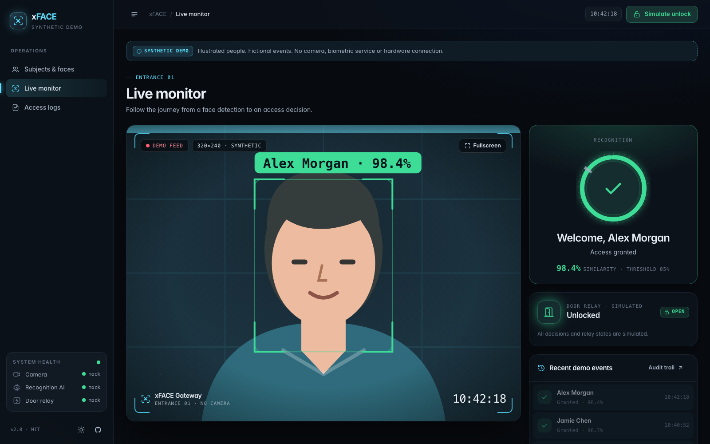
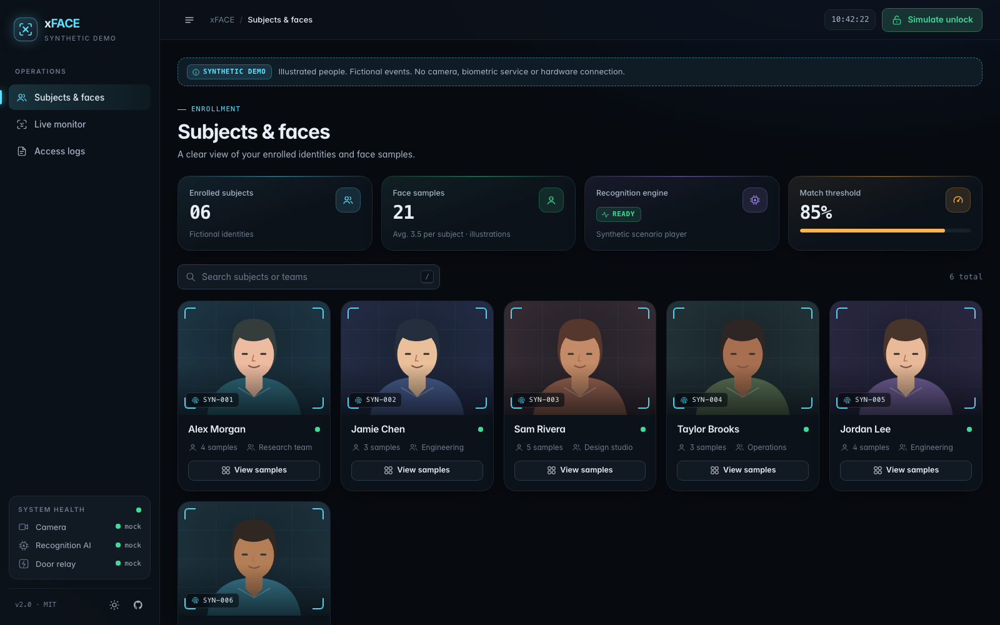
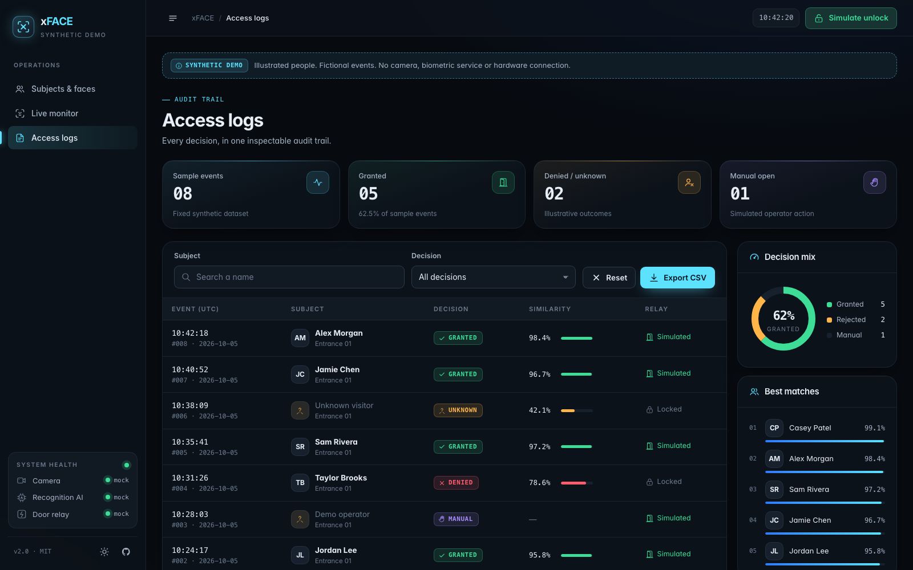
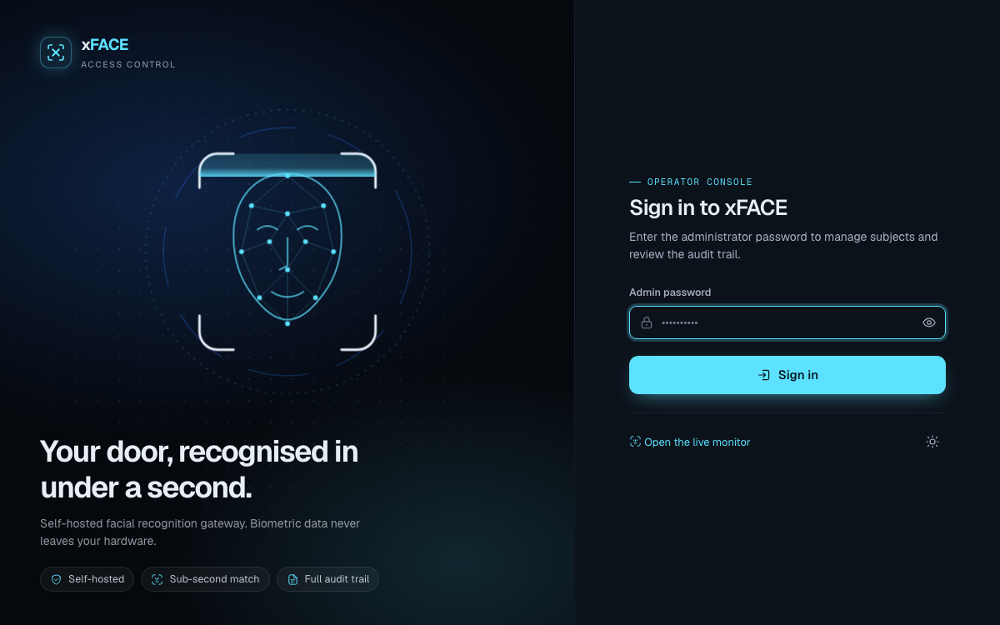
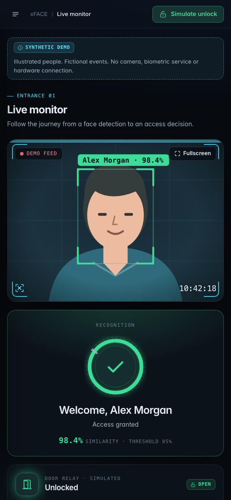
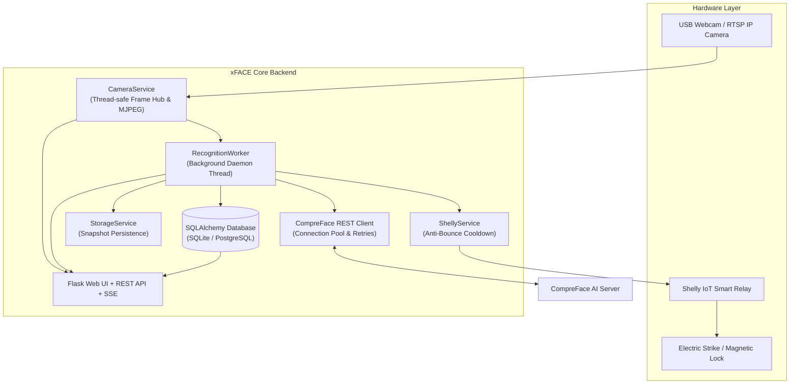

# xFACE: Open-Source Facial Recognition Access Control & Smart Lock System

[](https://github.com/KOKUTBON/xFACE/actions/workflows/tests.yml)
[](LICENSE)
[](https://www.python.org/)
[](https://flask.palletsprojects.com/)
[](https://opencv.org/)
[](https://github.com/exadel-inc/CompreFace)
[](docker-compose.yml)
[](CONTRIBUTING.md)

**xFACE** is an open-source, self-hosted biometric access-control reference application. It includes a synthetic demo and optional integrations for CompreFace, cameras, and Shelly relays. The public demo never contacts real biometric or hardware services.

Everything runs on your own hardware—from a Linux server to a Raspberry Pi. **100% self-hosted. Zero cloud subscriptions. Zero vendor lock-in.**

<p align="center">
  
</p>

---

## Contents

- [About](#about)
- [Key Features](#key-features)
- [Screenshots](#screenshots)
- [Architecture](#architecture)
- [Technology Stack](#technology-stack)
- [Quick Start](#quick-start)
  - [Requirements](#requirements)
  - [Option A: Docker Compose (Recommended)](#option-a-docker-compose)
  - [Option B: Local Virtual Environment](#option-b-local-virtual-environment)
- [Configuration Reference](#configuration-reference)
- [Web Interface](#web-interface)
- [REST API](#rest-api)
- [Data & Research Use](#data--research-use)
- [Development & Testing](#development--testing)
- [Repository Structure](#repository-structure)
- [Production Deployment](#production-deployment)
- [Responsible Use & Biometric Privacy](#responsible-use--biometric-privacy)
- [Code of Conduct](#code-of-conduct)
- [Contributing](#contributing)
- [Security](#security)
- [Changelog](#changelog)
- [License](#license)

---

## About

Commercial biometric turnstiles, badge readers, and proprietary facial recognition gates lock organizations into expensive recurring SaaS licenses, closed firmware, and opaque third-party cloud data transmission.

**xFACE** delivers a transparent, privacy-first, fully customizable alternative designed for universities, co-working spaces, corporate headquarters, apartment buildings, and smart homes. By combining standard off-the-shelf cameras with affordable IoT smart relays (such as Shelly 1, Shelly Plus, or Shelly Pro), xFACE provides sub-second facial recognition, anti-bounce door strike actuation, and centralized web enrollment.

In addition to day-to-day access control, xFACE serves as a practical, open foundation for **biometrics research and edge computer vision experimentation**: every recognition event logs similarity scores, detection probabilities, bounding boxes, and timestamped frames ready for CSV export and statistical evaluation.

### Search Keywords & Indexing
- **Primary Keywords**: Open Source Facial Recognition Access Control, Biometric Door Lock System Python, CompreFace Smart Lock Integration, Shelly Relay Door Opener, Face Recognition Edge AI Kiosk, Raspberry Pi Biometric Security Gateway, Real-Time Computer Vision Door Strike, xFACE Biometric Security.
- **Classification**: Physical Access Control System (PACS), Biometrics, Computer Vision, Edge AI, Smart Building Automation, IoT Relay Controller.

---

## Key Features

- **Autonomous Background Recognition**: A dedicated background daemon (`RecognitionWorker`) continuously processes camera frames. No web browser needs to remain open for the door to unlock.
- **Door Relay Control**: Native integration with Shelly Gen1 (`/relay`) and Gen2+ (`/rpc`) smart relays over local HTTP, featuring configurable pulse timers and per-person cooldowns to prevent door slamming.
- **Enrollment Dashboard**: Manage subjects via uploaded photos or live webcam frame snapshots; view, add, or delete individual face training samples; rename or remove subjects with instant CompreFace sync.
- **Live Kiosk Monitor**: Fullscreen, zero-latency MJPEG video stream with real-time Server-Sent Events (SSE): welcome messages, similarity scores, gate lock status, cooldown timers, and recent transit feeds.
- **Relational Audit Trail**: Filterable, paginated history (`GRANTED`, `DENIED`, `UNKNOWN`, `MANUAL_OPEN`) stored in SQLite/PostgreSQL with snapshot previews and filtered CSV export.
- **Robust Camera Ingestion**: Thread-safe frame hub with re-entrant locks (`RLock`) supporting USB device indices, RTSP/HTTP camera URLs, and video files with automatic reconnection.
- **Hardened Privacy & Security**: Salted `scrypt` password hashing, path traversal defenses on all storage operations, session hardening (`HttpOnly`, `SameSite=Lax`), and strict backend isolation of CompreFace API keys.
- **Single-Command Deployment**: Docker Compose bundles CompreFace Core ML, API, Admin UI, PostgreSQL database, and xFACE.

---

## Screenshots

> All people shown are illustrated avatars rendered for this demo. No real biometric data appears in these images.

### Live Monitor (Entrance Kiosk)

Shown at the top of this page: a real-time MJPEG feed with SSE-driven feedback. It displays a welcome message with the similarity score, the door lock state, the repeat-access cooldown, and a feed of recent events.

## Static GitHub Pages demo

A ready-to-publish, pre-rendered dashboard lives in `site/`: **Subjects & Faces**,
**Live Monitor**, and **Access Logs**, with illustrated synthetic identities,
scenario playback, search, filtering and CSV export. It needs no Flask server,
camera, biometric API or relay. All assets are served locally from the site.

```bash
python3 scripts/build_demo.py
python3 -m http.server 8080 --bind 127.0.0.1 --directory site
```

Open [the local preview](http://127.0.0.1:8080/). See [demo/README.md](demo/README.md)
for build details and publication steps. The Pages workflow runs **only on manual
request**; pushing changes does not automatically publish it.

## Demo configuration vs production deployment

The default `DEMO_MODE=true` uses `MockFaceProvider`, `MockDoorController`, a synthetic camera, and test subjects. It is intended for evaluation and development only; no CompreFace API key, camera URL, relay address, real face, embedding, snapshot, access log, or production configuration is required.

For production, explicitly set `DEMO_MODE=false`, provide managed secrets and private service URLs, keep `MONITOR_REQUIRE_LOGIN=true`, configure explicit `CORS_ORIGINS` only if needed, and follow [SECURITY.md](SECURITY.md). Production deployment requires a privacy/legal review and appropriate consent.

### Subjects & Faces Dashboard

Enroll people, curate their face samples, and control the recognition engine and match threshold. The sidebar shows live camera, AI engine, and relay health; the top bar has a manual **Open door** button. Dark control-room theme by default, with a light theme toggle.



### Access Logs & Audit Trail

Daily statistics, filters by subject, status, and date range, snapshot evidence for every event, and CSV export.



<table>
  <tr>
    <td align="center" width="68%">
      <br>
      <sub><b>Admin sign-in</b>: password hashed with salted <code>scrypt</code></sub>
    </td>
    <td align="center" width="32%">
      <br>
      <sub><b>Responsive kiosk</b>: works on tablets and phones</sub>
    </td>
  </tr>
</table>

---

## Architecture



---

## Technology Stack

| Layer | Technology |
|---|---|
| **Core Language** | Python 3.10+ (tested through Python 3.14) |
| **Web & API** | Flask 3.1, Jinja2, Werkzeug, Server-Sent Events (SSE) |
| **Computer Vision** | OpenCV (`cv2`), Pillow, NumPy |
| **Face Recognition Engine** | Exadel CompreFace (Inception-ResNet / InsightFace) |
| **Database & ORM** | SQLAlchemy 2.0 (SQLite default, PostgreSQL supported) |
| **Hardware Control** | Shelly relays (Gen1 `/relay`, Gen2+ `/rpc` over local HTTP) |
| **Security & Auth** | Werkzeug `scrypt` hashing, session cookies, path traversal sanitizers |
| **Frontend & UI** | Framework-free design system (CSS custom properties, dark/light themes), custom biometric SVG icon set, Geist typeface, Vanilla JavaScript (ES6+) |
| **DevOps & Packaging** | Docker Compose, Gunicorn, systemd, PEP 621 (`pyproject.toml`) |
| **Testing & Quality** | Pytest 9.x, Ruff linter |

---

## Quick Start

### Requirements

- Linux, macOS, or Windows
- Python 3.10+ **or** Docker with Docker Compose
- A standard USB webcam, an RTSP IP camera, or a video file for testing
- A running CompreFace instance (included in the Docker Compose setup)
- *(Optional)* A Shelly smart relay wired to an electric door strike

---

### Option A: Docker Compose

Run the public synthetic demo with a single command:

```bash
# 1. Clone the repository
git clone https://github.com/KOKUTBON/xFACE.git
cd xFACE

# 2. Configure environment parameters
cp .env.example .env

# 3. Launch the mock-only xFACE demo (no CompreFace, camera, or relay is contacted)
docker compose up -d
```

Access the interfaces:
- **xFACE Dashboard**: [http://localhost:5000/dashboard](http://localhost:5000/dashboard) (set `DASHBOARD_PASSWORD`, or read the first-install credential from `DATA_DIR/.admin_password`)
- **Live Entrance Kiosk**: [http://localhost:5000/monitor](http://localhost:5000/monitor)
- **Historical Access Logs**: [http://localhost:5000/logs](http://localhost:5000/logs)

To start the optional real CompreFace stack, set `DEMO_MODE=false`, configure all production secrets and private URLs, and start with `COMPREFACE_POSTGRES_PASSWORD` plus `docker compose --profile production up -d`. Review [SECURITY.md](SECURITY.md) first.

---

### Option B: Local Virtual Environment

```bash
# 1. Clone the repository
git clone https://github.com/KOKUTBON/xFACE.git
cd xFACE

# 2. Create and activate a Python virtual environment
python3 -m venv .venv
source .venv/bin/activate  # On Windows: .venv\Scripts\activate

# 3. Install production dependencies
pip install -r requirements.txt

# 4. Configure environment parameters
cp .env.example .env
# Edit .env with your CompreFace API_KEY and SHELLY_URL

# 5. Start xFACE
python run.py
```

---

## Configuration Reference

All settings are configured via environment variables or a `.env` file:

| Variable | Default | Description |
|---|---|---|
| `HOST` | `http://localhost` | CompreFace server URL |
| `PORT` | `8000` | CompreFace server port |
| `API_KEY` | *(required)* | Recognition service API key |
| `DETECTION_PROBABILITY_THRESHOLD` | `0.8` | Minimum face detection confidence (0.0 – 1.0) |
| `SIMILARITY_THRESHOLD` | `0.85` | Minimum cosine similarity to authorize entry (0.0 – 1.0) |
| `FACE_PLUGINS` | `age,gender` | Comma-separated CompreFace plugins |
| `SHELLY_URL` | *(empty)* | Full URL to trigger the relay |
| `SHELLY_TIMEOUT` | `3.0` | Seconds to wait for relay response |
| `SHELLY_COOLDOWN_SECONDS` | `10.0` | Minimum seconds between activations for the same person |
| `DASHBOARD_PASSWORD` | *(generated if empty)* | Admin password; no universal default exists |
| `SECRET_KEY` | *(generated)* | Flask session secret key (set a fixed value in production) |
| `MONITOR_REQUIRE_LOGIN` | `true` | Require login for `/monitor`, video, and SSE |
| `DEMO_MODE` | `true` | Use synthetic provider/camera/door; set `false` only for reviewed production integration |
| `CORS_ORIGINS` | *(empty)* | Comma-separated origins allowed to call the API cross-site |
| `CAMERA_INDEX` | `0` | Device index, RTSP/HTTP URL, or video file path |
| `CAMERA_WIDTH` / `CAMERA_HEIGHT` | `640` / `480` | Video capture resolution |
| `CAMERA_FPS` | `30` | Target capture frame rate |
| `RECOGNITION_INTERVAL` | `0.8` | Seconds between recognition requests |
| `DATA_DIR` | `./data` | Database, snapshots, and temporary files location |
| `DATABASE_URL` | SQLite in `DATA_DIR` | Any SQLAlchemy connection string (e.g., PostgreSQL) |
| `SNAPSHOT_RETENTION_DAYS` | `30` | Auto-delete snapshots older than N days (`0` = keep indefinitely) |
| `WEB_HOST` / `WEB_PORT` | `0.0.0.0` / `5000` | Bind address for the web server |
| `DEBUG` | `false` | Verbose logging and Flask debug mode |

**Shelly URL Examples:**
- **Gen1 (Shelly 1 / 1PM)**: `http://<relay-host>/relay/0?turn=on&timer=2`
- **Gen2+ (Plus / Pro)**: `http://<relay-host>/rpc/Switch.Set?id=0&on=true&toggle_after=2`

The `timer` / `toggle_after` parameter ensures the relay pulses and switches off automatically at the hardware level.

---

## Web Interface

| Page | Path | Access |
|---|---|---|
| **Subjects & Faces** | `/dashboard` | Admin |
| **Live Monitor (Kiosk)** | `/monitor` | Admin (login required by default) |
| **Access Logs** | `/logs` | Admin |
| **Sign In** | `/login` | Public |

- **Subjects & Faces**: Enroll individuals via file upload or live camera snapshot, add supplementary biometric samples (3–5 diverse photos improve accuracy), browse and delete samples, rename or delete subjects, pause/resume recognition, restart camera devices, and trigger door strikes manually.
- **Live Monitor**: Designed for entrance totems, wall-mounted tablets, and Raspberry Pi kiosks. Displays live video, glowing welcome feedback for recognized people, red alerts for unknown visitors, lock state indicators, cooldown progress, and recent events. Includes a fullscreen toggle.
- **Access Logs**: Daily statistics, multi-criteria filtering by subject, status (`GRANTED`, `DENIED`, `UNKNOWN`, `MANUAL_OPEN`), and date range, with thumbnail photo previews and filtered CSV export.

---

## REST API

All endpoints share the same origin as the web interface. Endpoints marked *(Admin)* require an authenticated session cookie.

### Subjects & Enrollment

| Method | Endpoint | Description |
|---|---|---|
| `GET` | `/api/v1/subjects` | Map of subject names to face image IDs *(Admin)* |
| `POST` | `/api/v1/subjects` | Create subject. `multipart/form-data` with `subject` and one of `image`, `photo_data`, or `capture_from_webcam=true` *(Admin)* |
| `PUT` | `/api/v1/subjects/<name>` | Rename subject. JSON `{"new_name": "..."}` *(Admin)* |
| `DELETE` | `/api/v1/subjects/<name>` | Delete subject and associated face vectors *(Admin)* |
| `POST` | `/api/v1/subjects/<name>/images` | Add face sample image *(Admin)* |
| `DELETE` | `/api/v1/images/<id>` | Delete single face sample *(Admin)* |
| `GET` | `/api/v1/proxy/images/<id>` | Securely proxy face sample image from CompreFace *(Admin)* |

### Access Logs & Analytics

| Method | Endpoint | Description |
|---|---|---|
| `GET` | `/api/v1/logs` | Paginated access logs. Query params: `page`, `per_page`, `status`, `subject`, `start_date`, `end_date` *(Admin)* |
| `GET` | `/api/v1/logs/stats` | Summary statistics for today and all time *(Admin)* |
| `GET` | `/api/v1/logs/export` | Download filtered access logs as CSV *(Admin)* |

### System & Video

| Method | Endpoint | Description |
|---|---|---|
| `GET` | `/api/v1/system/status` | Health of camera, CompreFace, relay, and worker |
| `POST` | `/api/v1/system/camera/restart` | Safely reopen camera device *(Admin)* |
| `POST` | `/api/v1/system/recognition/toggle` | Pause or resume recognition loop *(Admin)* |
| `POST` | `/api/v1/system/shelly/trigger` | Manually activate door relay (logged as `MANUAL_OPEN`) *(Admin)* |
| `GET` | `/api/v1/system/events` | Server-Sent Events (SSE) stream of live detections |
| `GET` | `/video/stream` | Multipart zero-latency MJPEG video stream |
| `GET` | `/video/snapshot` | Single immediate JPEG frame capture |
| `GET` | `/video/snapshots/<file>` | Stored access log photo snapshot *(Admin)* |

---

## Data & Research Use

xFACE records every recognition decision, making it a valuable tool for analyzing real-world face recognition behavior: confidence score distributions, false accept/reject rates (FAR/FRR), lighting variations, camera angle sensitivity, and throughput.

**What is Stored Locally** (in `DATA_DIR`, never committed to git):

| Storage | Content |
|---|---|
| `access_logs` | Timestamp (UTC), subject name, similarity score, status, relay outcome, device name, snapshot filename, notes |
| `subjects_metadata` | Enrollment date, last access timestamp, total access count per person |
| `snapshots/` | Timestamped JPEG frames captured for each logged event (auto-purged after `SNAPSHOT_RETENTION_DAYS`) |

*Note: Raw face training vectors and embeddings are stored inside CompreFace.*

**Extracting Data for Analysis:**
```python
import pandas as pd

# Analyze exported CSV logs
df = pd.read_csv("xface_access_logs.csv", parse_dates=["timestamp_utc"])
print(df.groupby("status")["similarity"].describe())
```

---

## Development & Testing

```bash
# Install development dependencies
pip install -r requirements-dev.txt

# Run linter
ruff check .

# Run test suite
pytest
```

The test suite runs against a temporary database and data directory, using mocks for CompreFace, the Shelly relay, and camera devices. No physical hardware or live services are required to run tests.

---

## Repository Structure

```text
├── docs/screenshots/     # UI and kiosk screenshots for documentation
├── tests/                # Automated unit and integration test suite
├── xface/
│   ├── config.py         # Pydantic Settings and environment configuration
│   ├── core/             # Exceptions and security (password hashing, path checks)
│   ├── database/         # SQLAlchemy models and database session management
│   ├── services/         # Camera, CompreFace client, background worker, Shelly relay
│   └── web/              # Flask application, blueprints, templates, and static assets
├── .dockerignore
├── .env.example          # Sample environment configuration template
├── .gitignore
├── CHANGELOG.md          # Release notes and version history
├── CODE_OF_CONDUCT.md    # Contributor Covenant Code of Conduct
├── CONTRIBUTING.md       # Development and contribution guide
├── Dockerfile            # Multi-stage production container definition
├── docker-compose.yml    # Full stack orchestration (xFACE + CompreFace + PostgreSQL)
├── LICENSE               # MIT License
├── pyproject.toml        # PEP 621 packaging metadata and tool configurations
├── requirements.txt      # Production Python dependencies
├── requirements-dev.txt  # Development and testing dependencies
├── run.py                # Application entrypoint
├── SECURITY.md           # Security reporting policy
├── start_dashboard.sh    # Convenience shell launcher
└── xface.service         # systemd unit file for Linux deployment
```

---

## Production Deployment

xFACE must run as a **single process** because the camera feed and background recognition worker are in-process singletons. Concurrency is handled via threads:

```bash
pip install -r requirements.txt
gunicorn --workers 1 --threads 32 --timeout 120 --bind 0.0.0.0:5000 run:app
```

### systemd (Linux / Raspberry Pi OS)

```bash
# 1. Create a dedicated system user
sudo useradd --system --groups video --home /opt/xface xface
sudo chown -R xface:xface /opt/xface

# 2. Install and enable systemd service
sudo cp xface.service /etc/systemd/system/
sudo systemctl daemon-reload
sudo systemctl enable --now xface

# 3. View service logs
sudo journalctl -u xface -f
```

Deploy behind a reverse proxy (Nginx or Caddy) with HTTPS enabled, and ensure response buffering is disabled for `/video/stream` and `/api/v1/system/events`.

---

## Responsible Use & Biometric Privacy

Facial recognition processes sensitive biometric data subject to legal regulations (including GDPR Art. 9, Illinois BIPA, and regional privacy frameworks). When deploying xFACE:

- Obtain informed, explicit consent from all enrolled individuals and provide non-biometric access alternatives (RFID badge, keycard, PIN).
- Post clear, visible signage indicating video surveillance and biometric processing.
- Maintain short retention periods (`SNAPSHOT_RETENTION_DAYS`) and promptly fulfill data deletion requests.
- Anonymize data before sharing logs or snapshots for academic research.
- Do not deploy xFACE for covert surveillance or unconsented identification.

---

## Code of Conduct

xFACE is dedicated to providing a respectful, welcoming, harassment-free environment for all contributors and users. Please review and adhere to our [Code of Conduct](CODE_OF_CONDUCT.md) based on the Contributor Covenant v2.1.

---

## Contributing

Contributions from the open-source community are warmly welcomed! Whether fixing bugs, improving documentation, adding new IoT relay integrations (MQTT, Zigbee, ESP32), or developing anti-spoofing/liveness detection filters, please review our [Contributing Guidelines](CONTRIBUTING.md) before submitting a Pull Request.

---

## Security

Security and biometric confidentiality are fundamental priorities. If you discover a vulnerability:
- **Do not open a public GitHub issue.**
- Review our [Security Policy](SECURITY.md) and report vulnerabilities confidentially via GitHub Security Advisories or by contacting the maintainers.

---

## Changelog

See [CHANGELOG.md](CHANGELOG.md) for a detailed history of changes, fixes, and release notes across versions.

---

## License

This project is licensed under the terms of the **MIT License**. See the [LICENSE](LICENSE) file for the full legal text.

Copyright (c) 2026 Rei Doda & xFACE Contributors.

## KOKUTBON community and support

Open technology for the benefit of humankind — built by people, for people, and freely reusable by everyone.

Read [Contributing](CONTRIBUTING.md), [Code of Conduct](CODE_OF_CONDUCT.md), [Support](SUPPORT.md), [Governance](GOVERNANCE.md) and [Security](SECURITY.md). Help sustain the work through [GitHub Sponsors and other contributions](SPONSORSHIP.md). Maintainer release requirements are documented in [Release checklist](RELEASE_CHECKLIST.md).

## Source publication

See [source publication status](SOURCE_PUBLICATION.md) and [local validation record](PUBLICATION_VALIDATION.md) for the initial distribution and remaining release checks.
